<p align="center">
  <a href="https://cafu1107.github.io/pota/">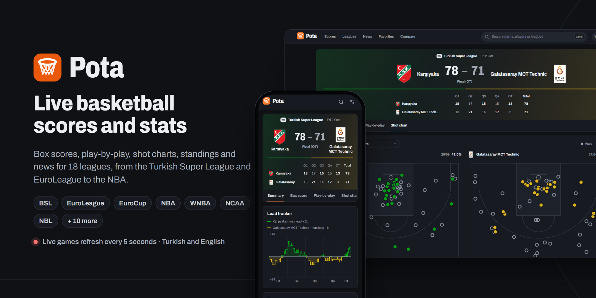</a>
</p>

<p align="center"><b>Live basketball scores, box scores, shot charts, standings and news for 18 leagues, in Turkish and English.</b></p>

<p align="center">
  <a href="https://cafu1107.github.io/pota/"></a>
</p>

<p align="center">
  <a href="https://github.com/Cafu1107/pota/actions/workflows/ci.yml"></a>
  <a href="https://github.com/Cafu1107/pota/actions/workflows/pages.yml"></a>
  <a href="LICENSE"></a>
  
  
  
</p>

<p align="center">English · <a href="README.tr.md">Türkçe</a></p>

<p align="center">
  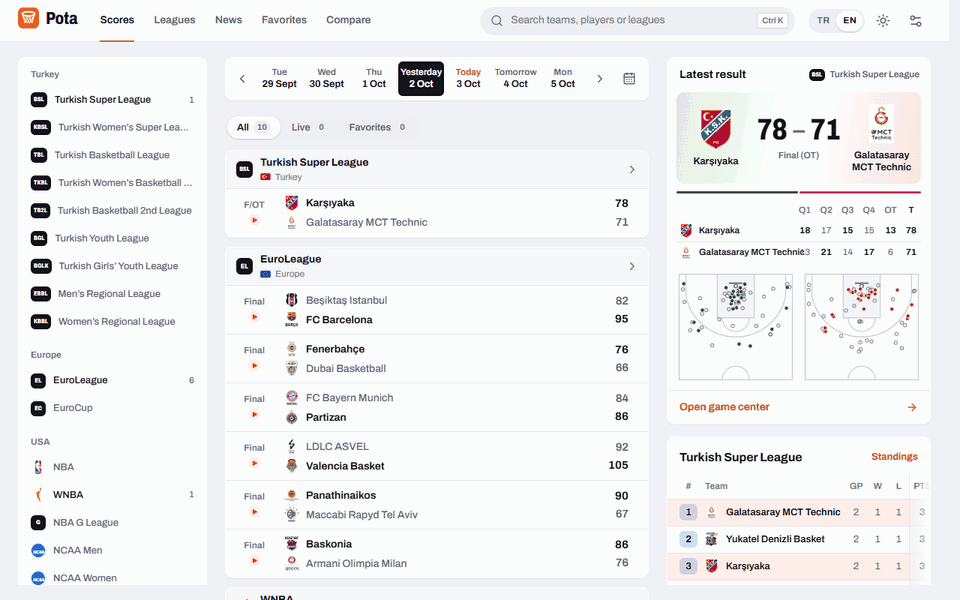
</p>

## What's inside

| ⚡ Live | 📊 Game center | 🏆 Leagues |
|---|---|---|
| Every game of the day, grouped by league. Live games refresh every 5 seconds; a new basket rolls the score and flashes the row once. | Box score, play-by-play with filters, shot chart, lead tracker, team stats side by side and the game's leaders. | Fixtures by round or date, standings with playoff, play-in and relegation zones, stat leaders and every team. |
| **⭐ Favorites** | **🆚 Compare** | **📰 News** |
| Star teams to pin their games to the top, and pin the leagues you follow. | Two players or two teams, season averages side by side. | Basketball headlines from TBF, NTV Spor, TRT Spor, Fotomaç, Eurohoops and ESPN, filtered by topic or source. Every story opens on the outlet that published it. |

Also: team pages (next game, recent games, season stats, roster), player pages (bio, averages, game log, career), search with <kbd>Ctrl</kbd> <kbd>K</kbd> that finds "Besiktas" when you type it without Turkish letters, light and dark themes, and an installable app that opens with the last known data when you are offline.

## Screenshots

<table>
  <tr>
    <td width="50%">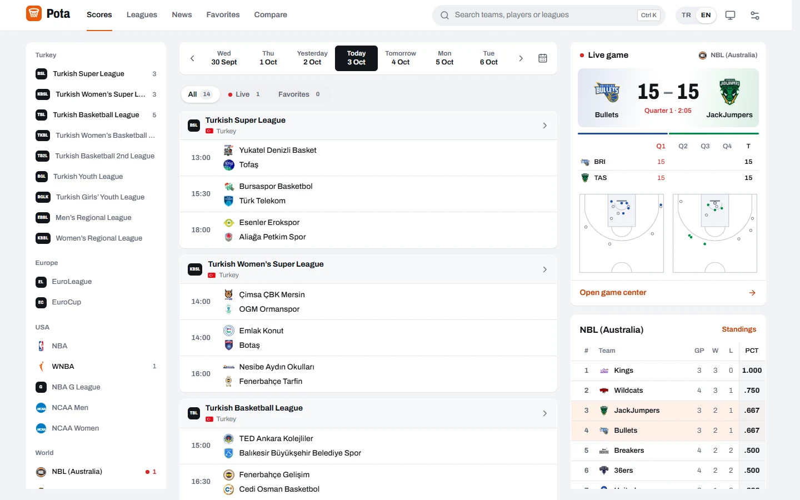</td>
    <td width="50%">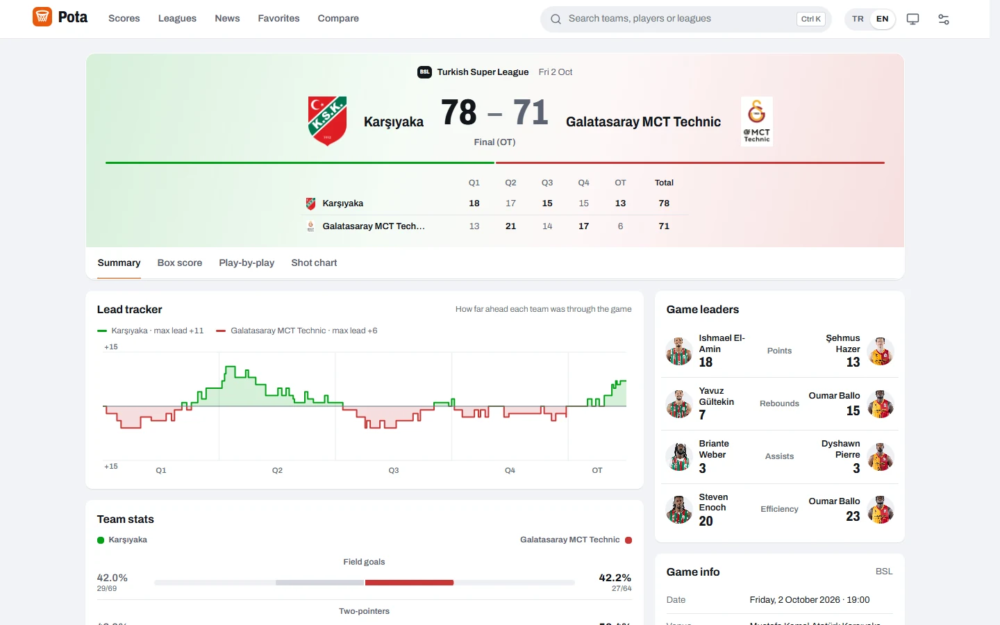</td>
  </tr>
  <tr>
    <td>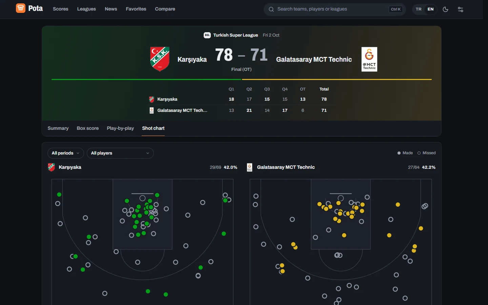</td>
    <td>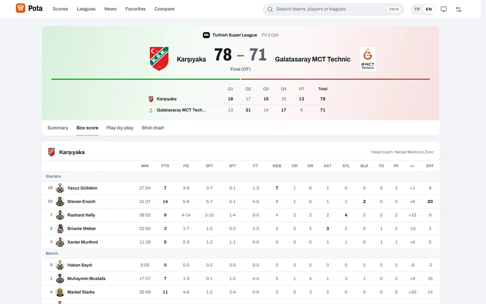</td>
  </tr>
  <tr>
    <td>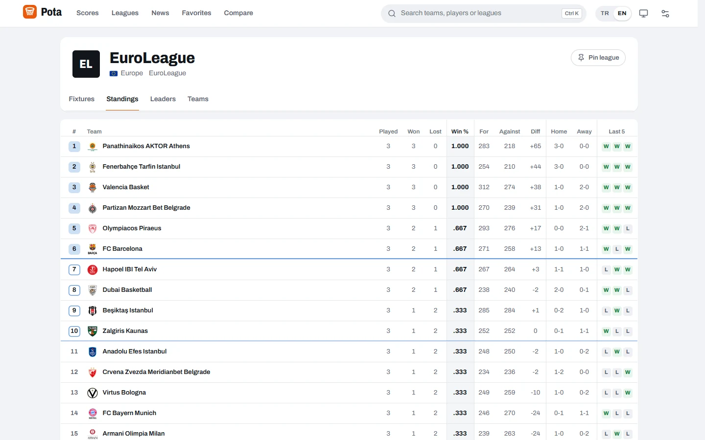</td>
    <td>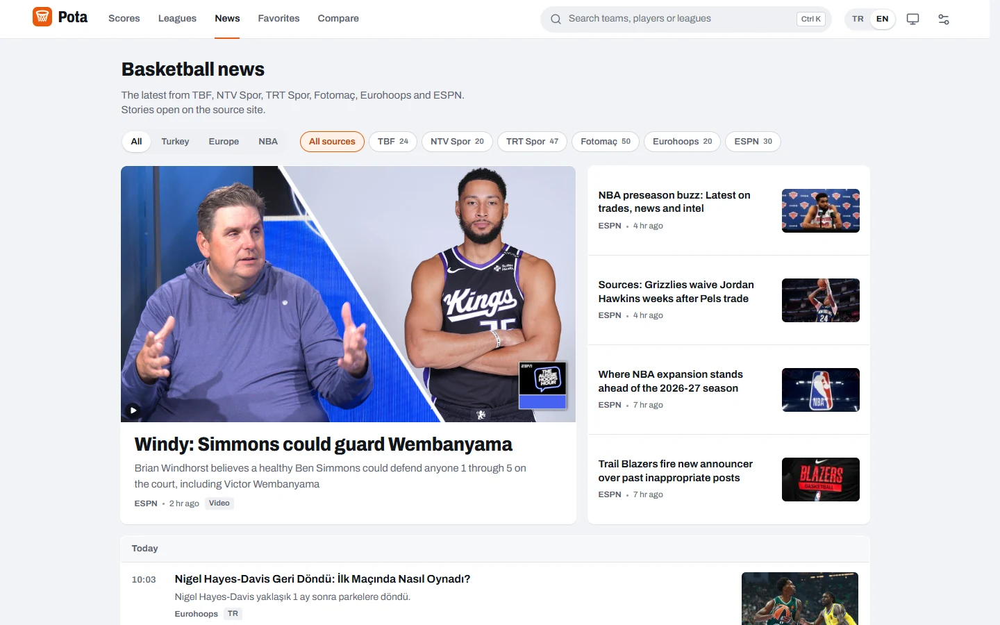</td>
  </tr>
</table>

<p align="center">
  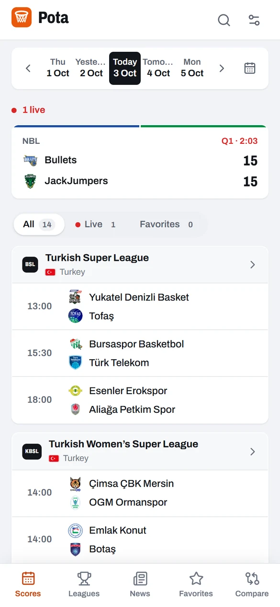
  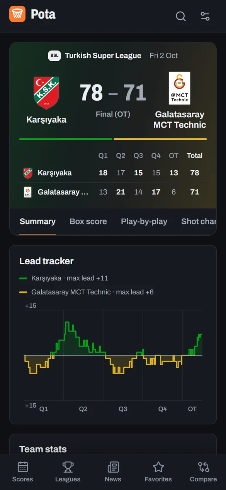
  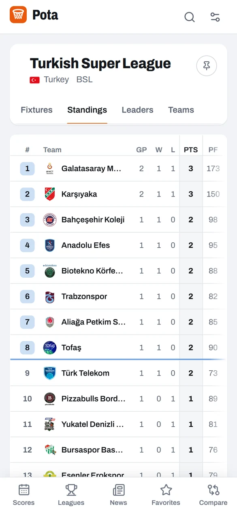
  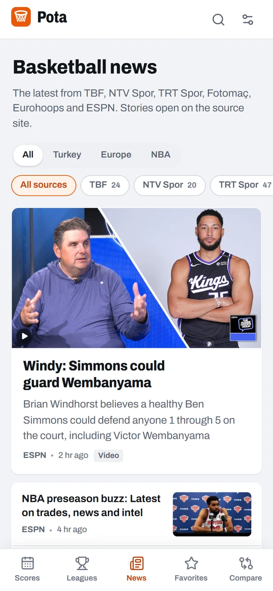
</p>

## Leagues and data

| Region | Leagues | Source |
|---|---|---|
| Turkey | Turkish Super League (BSL), Women's Super League, TBL, TKBL, TB2L, youth and regional leagues | TBF web service, live data from FIBA LiveStats |
| Europe | EuroLeague, EuroCup | EuroLeague's API |
| USA | NBA, WNBA, G League, NCAA men and women | ESPN |
| World | NBL (Australia), FIBA national teams | ESPN |

The TBF service and ESPN are public but unofficial endpoints. Pota is an independent project and is not affiliated with TBF, FIBA, EuroLeague, ESPN or any news outlet. Logos, photos and articles belong to their owners.

## Built to be fast

- **One shared cache in front of every source.** All requests go through a small proxy that answers from memory and refreshes stale copies in the background, so a refresh rarely waits on the source. Locally it is `server/proxy.mjs`; the live demo runs the same rules in a Cloudflare Worker (`deploy/worker`).
- **Tiny live updates.** Score lists poll a condensed feed for live Turkish games: about 0.3 KB per game instead of the 440 KB a full FIBA LiveStats game file weighs.
- **Data arrives before you click.** Hovering or touching a game, a team or another day starts loading it, and the pages you are likely to open next load while the browser is idle.
- **Return visits paint from your device.** The last data is kept in IndexedDB, shown at once and refreshed behind the scenes. On the local server all 18 leagues load in about a third of a second, and a return visit shows them in about 25 ms.

## Use it

1. Open the **[live demo](https://cafu1107.github.io/pota/)**.
2. Install it if you like: "Install app" in Chrome or Edge, or "Add to Home Screen" on a phone.
3. Star your teams. Their games stay at the top of the scores page.

### Run it on your computer

You need [Node.js](https://nodejs.org) 20 or newer.

```bash
npm install
npm run serve    # builds, then serves http://localhost:4173
```

On Windows you can double-click `Pota.cmd`: it installs, builds, starts the server and opens the browser. The server also prints a network address (`http://192.168.x.x:4173`) so a phone on the same Wi-Fi can open it.

<details>
<summary><b>For developers</b></summary>

```bash
npm run dev        # Vite dev server with the proxy: http://localhost:5173
npm test           # unit tests, no network needed
npm run test:live  # smoke test against the real APIs
npm run build      # type check and production build into dist/
```

**How it fits together**

- Each source has an adapter in `src/data/providers/` (`tbf.ts`, `euroleague.ts`, `espn.ts`) that maps it onto one model (`src/data/types.ts`). Pages never know where data came from.
- News lives in `src/data/news.ts`: the TBF API plus RSS and Atom feeds, merged, de-duplicated and tagged Turkey, Europe or NBA.
- `server/upstreams.mjs` holds the allowlist and cache rules that both the local proxy and the Worker use.
- Live Turkish games come from FIBA LiveStats, because the TBF service lags during games.
- UI text is in `src/i18n/tr.ts` and `src/i18n/en.ts`; every key exists in both.

**Deploying your own copy**

1. Deploy the proxy: `cd deploy/worker && npm install && npx wrangler login && npm run deploy`. Add your site's origin to `ALLOWED_ORIGINS` in `wrangler.toml`.
2. In the GitHub repo, set the Actions variable `POTA_PROXY_BASE` to `https://<worker>.<account>.workers.dev/proxy` and choose "GitHub Actions" as the Pages source.
3. Push to `main`. `.github/workflows/pages.yml` builds with `VITE_BASE=/<repo>/` and deploys.

</details>

## FAQ

<details>
<summary><b>Why does the demo need a Cloudflare Worker?</b></summary>

GitHub Pages only serves files. TBF and FIBA LiveStats do not let other websites call them from the browser (CORS), so the demo goes through a small Worker that adds the right headers and caches responses. It only forwards to a fixed list of sources, and browsers may only call it from the demo's own address.
</details>

<details>
<summary><b>How fresh are live scores?</b></summary>

A live game page refreshes every 5 seconds and score lists every 8 seconds. Each source adds its own delay on top of that.
</details>

<details>
<summary><b>A league shows no games.</b></summary>

It is probably between seasons or on a break. For the ESPN leagues (NBA, WNBA, NCAA and others) the standings show the last completed season until the new one starts.
</details>

## Contributing

Bug reports and league requests are welcome in [Issues](https://github.com/Cafu1107/pota/issues). See [CONTRIBUTING.md](CONTRIBUTING.md) before opening a pull request.

## License

[GPL-3.0-or-later](LICENSE). Data, logos, photos and news articles belong to their respective owners.
