<p align="center">
  <a href="https://cafu1107.github.io/pota/">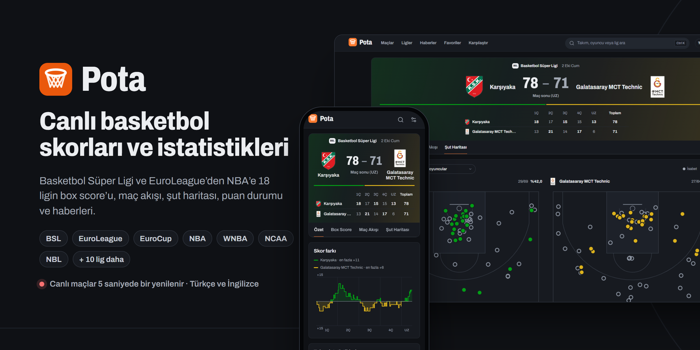</a>
</p>

<p align="center"><b>18 ligin canlı skorları, box score'ları, şut haritaları, geçmiş maçları, maç özetleri, yorumları, puan durumları ve haberleri; Türkçe ve İngilizce.</b></p>

<p align="center">
  <a href="https://cafu1107.github.io/pota/"></a>
</p>

<p align="center">
  <a href="https://github.com/Cafu1107/pota/actions/workflows/ci.yml"></a>
  <a href="https://github.com/Cafu1107/pota/actions/workflows/pages.yml"></a>
  <a href="LICENSE"></a>
  
  
  
</p>

<p align="center"><a href="README.md">English</a> · Türkçe</p>

<p align="center">
  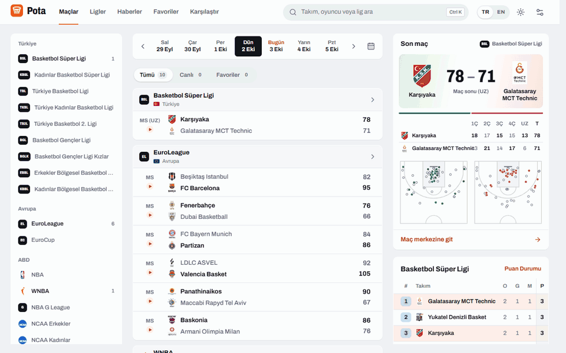
</p>

## Neler var

| ⚡ Canlı | 📊 Maç merkezi | 🏆 Ligler |
|---|---|---|
| Günün bütün maçları lig lig. Canlı maçlar 5 saniyede bir yenilenir; sayı olunca skor kayarak değişir ve satır bir kez parlar. | Box score, filtrelenebilir maç akışı, şut haritası, skor farkı grafiği, yan yana takım istatistikleri ve maçın yıldızları. | Tur ya da tarihe göre fikstür; play-off, play-in ve küme düşme bölgeleri belirgin puan durumu; istatistik liderleri ve takımlar. |
| **📜 Geçmiş maçlar** | **🎬 Maç özetleri** | **💬 Yorumlar** |
| İki takımın bütün karşılaşmaları (EuroLeague ve ESPN liglerinde son üç sezon, Türk liglerinde bu sezon), galibiyet sayıları, maç başı sayı, en farklı galibiyetler, iki takımın son 5 maçı ve sezon karşılaştırması. | Biten maçların özetleri resmî YouTube kanallarından oynatılır (EuroLeague, BSL için beIN SPORTS Türkiye, NBA, WNBA, NBL, FIBA); Türk liglerinde ve özeti olmayan NBL maçlarında maçın tamamı gösterilir. Maç listelerinde videosu olan maçlar işaretlenir. | Üye olmadan maç hakkında yaz. Yalnızca metin: bağlantı, fotoğraf ve video yok, sadece 6 emoji serbest; küfür ve argo otomatik sansürlenir. |
| **⭐ Favoriler** | **🆚 Karşılaştırma** | **📰 Haberler** |
| Yıldızladığın takımların maçları en üstte durur; takip ettiğin ligleri sabitleyebilirsin. | İki oyuncu ya da iki takım, sezon ortalamalarıyla yan yana. | TBF, NTV Spor, TRT Spor, Fotomaç, Eurohoops ve ESPN'den basketbol haberleri ve son maç özetleri; konuya ya da kaynağa göre süzülür. Her haber yayımlandığı sitede açılır. |

Ayrıca takım sayfaları (sıradaki maç, son maçlar, sezon istatistikleri, kadro), oyuncu sayfaları (künye, ortalamalar, maç maç istatistikler, kariyer), Türkçe karakter yazmasan da "besiktas" diye bulan <kbd>Ctrl</kbd> <kbd>K</kbd> araması, açık ve koyu tema, ve internet yokken son bilinen verilerle açılan yüklenebilir uygulama.

## Ekran görüntüleri

<table>
  <tr>
    <td width="50%">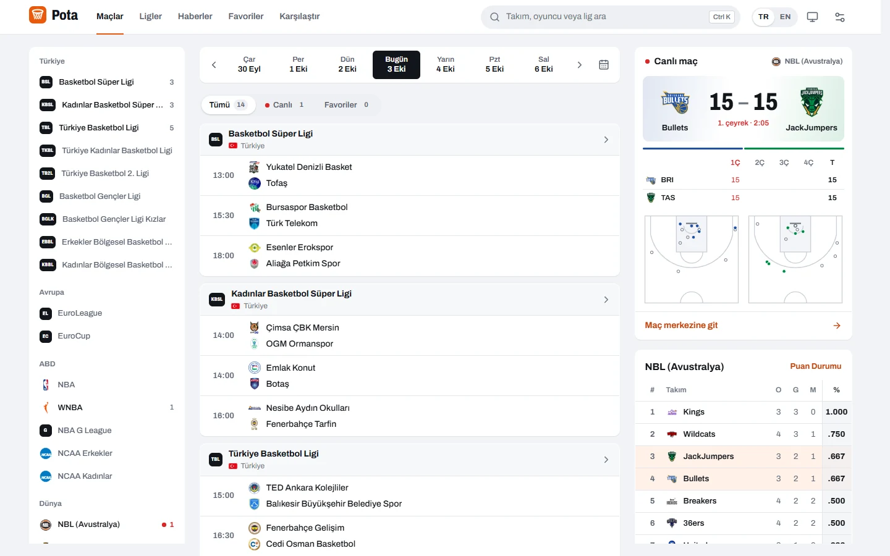</td>
    <td width="50%">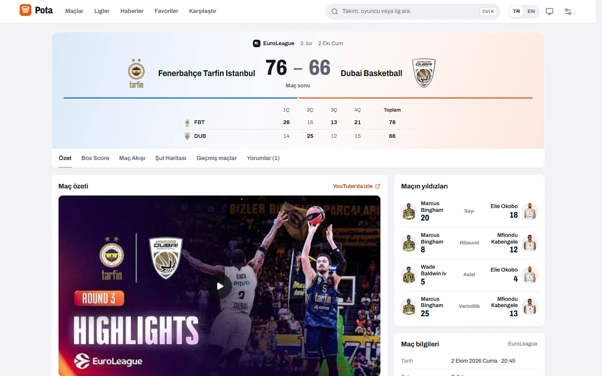</td>
  </tr>
  <tr>
    <td>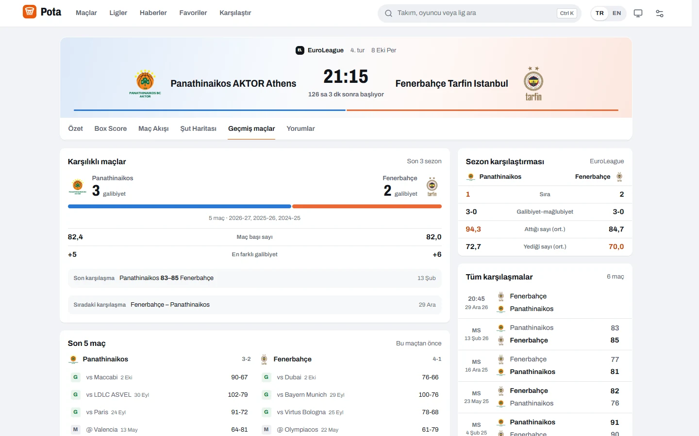</td>
    <td>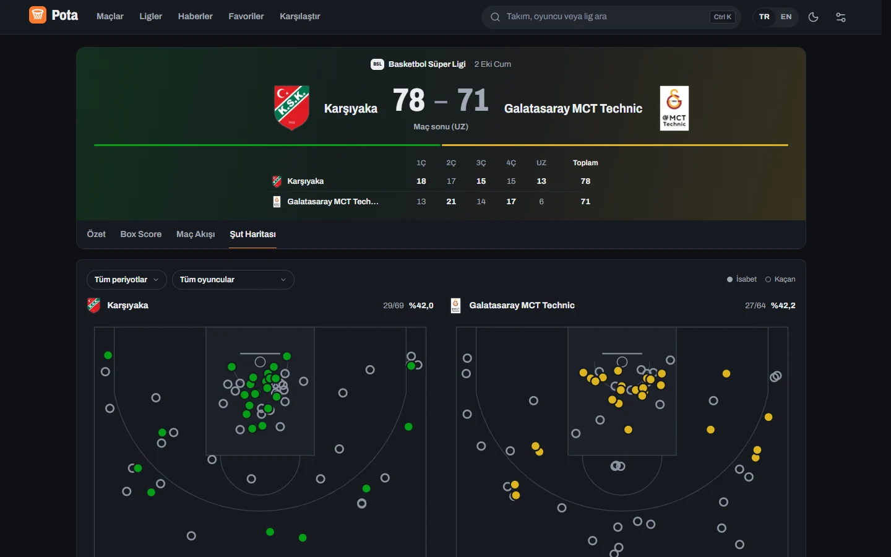</td>
  </tr>
  <tr>
    <td>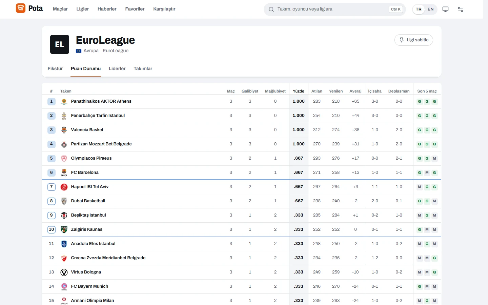</td>
    <td>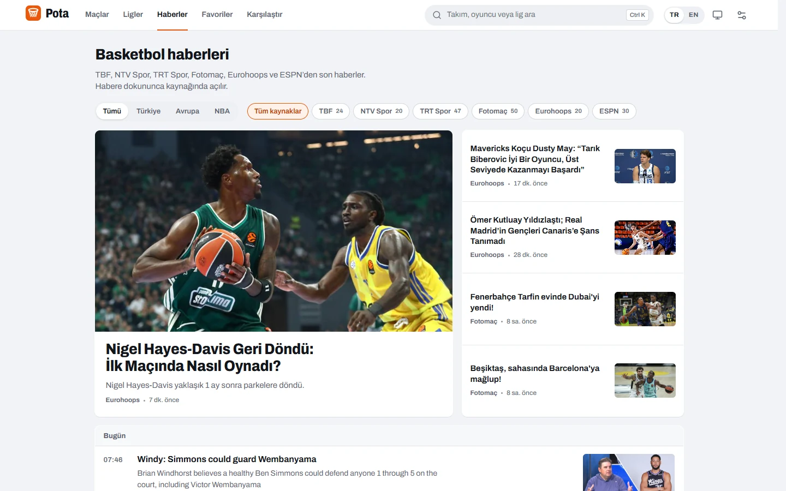</td>
  </tr>
</table>

<p align="center">
  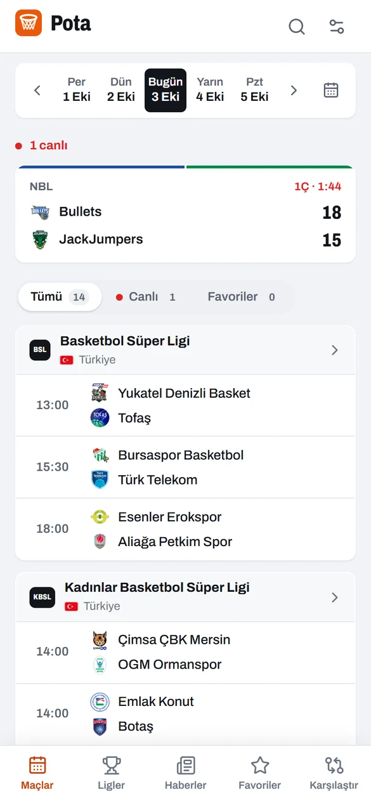
  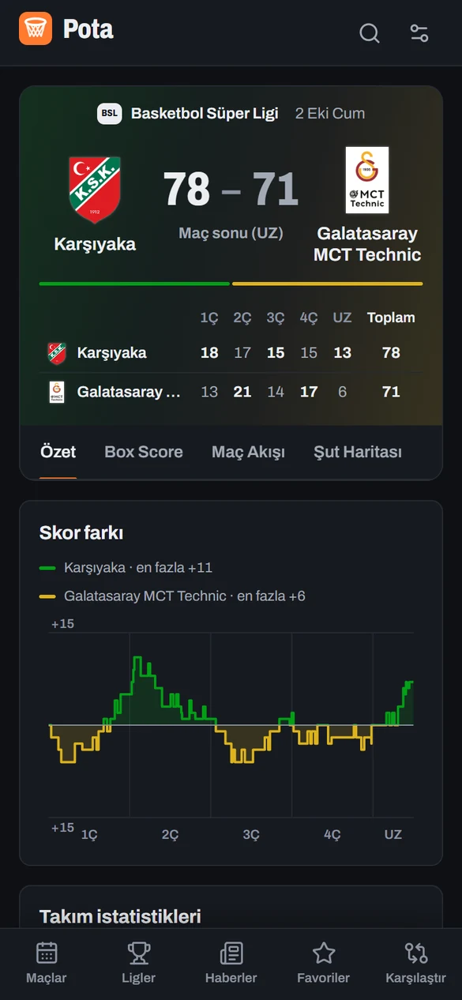
  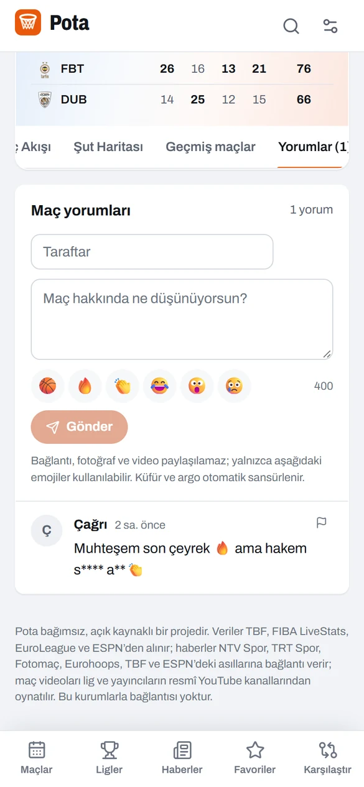
  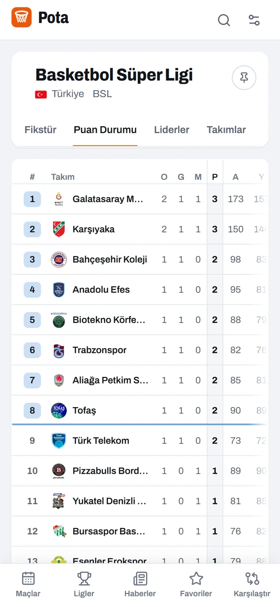
  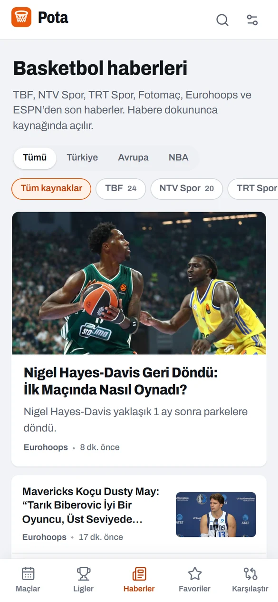
</p>

## Ligler ve veri kaynakları

| Bölge | Ligler | Kaynak |
|---|---|---|
| Türkiye | Basketbol Süper Ligi, Kadınlar Basketbol Süper Ligi, TBL, TKBL, TB2L, gençler ve bölgesel ligler | TBF web servisi, canlı veriler FIBA LiveStats'ten |
| Avrupa | EuroLeague, EuroCup | EuroLeague API |
| ABD | NBA, WNBA, G League, NCAA erkekler ve kadınlar | ESPN |
| Dünya | NBL (Avustralya), FIBA milli takımlar | ESPN |

TBF servisi ve ESPN herkese açık ama resmi olmayan kaynaklardır. Pota bağımsız bir projedir; TBF, FIBA, EuroLeague, ESPN ya da haber siteleriyle bağlantısı yoktur. Logolar, fotoğraflar ve haberler sahiplerine aittir.

## Neden hızlı

- **Bütün kaynakların önünde tek bir ortak önbellek.** Her istek, yanıtları bellekten veren ve eskiyen kopyayı arka planda tazeleyen küçük bir aracıdan geçer; yenileme neredeyse hiç kaynağı beklemez. Yerelde bu `server/proxy.mjs`, canlı demoda aynı kurallarla çalışan bir Cloudflare Worker'dır (`deploy/worker`).
- **Küçücük canlı güncellemeler.** Maç listeleri, canlı Türk maçları için sıkıştırılmış bir akışı yoklar: maç başına tam FIBA LiveStats dosyasının 440 KB'ı yerine yaklaşık 0,3 KB.
- **Veri, sen tıklamadan gelir.** Bir maçın, takımın ya da başka bir günün üstüne gelmek ya da dokunmak onu yüklemeye başlar; açman muhtemel sayfalar tarayıcı boştayken hazırlanır.
- **Tekrar gelişte veri cihazından gelir.** Son veriler IndexedDB'de saklanır, anında gösterilir ve arkada tazelenir. Yerel sunucuda 18 ligin tamamı yaklaşık üçte bir saniyede yüklenir, tekrar açılışta yaklaşık 25 ms'de ekrandadır.

## Kullanım

1. **[Canlı demoyu](https://cafu1107.github.io/pota/)** aç.
2. İstersen uygulama olarak yükle: Chrome ya da Edge'de "Uygulamayı yükle", telefonda "Ana ekrana ekle".
3. Takımlarını yıldızla; maçları, maçlar sayfasında en üstte durur.

### Kendi bilgisayarında çalıştır

[Node.js](https://nodejs.org) 20 veya üstü gerekir.

```bash
npm install
npm run serve    # derler ve http://localhost:4173 adresinde açar
```

Windows'ta `Pota.cmd` dosyasına çift tıklamak yeterli: gerekirse kurar, derler, sunucuyu başlatıp tarayıcıyı açar. Sunucu bir de ağ adresi yazar (`http://192.168.x.x:4173`); aynı Wi-Fi'deki telefondan bu adresle açabilirsin.

<details>
<summary><b>Yazılımcılar için</b></summary>

```bash
npm run dev        # aracılı Vite geliştirme sunucusu: http://localhost:5173
npm test           # birim testleri, ağ gerekmez
npm run test:live  # gerçek API'lere karşı duman testi
npm run build      # tip kontrolü ve dist/ içine üretim derlemesi
```

**Yapı**

- Her kaynağın `src/data/providers/` altında bir sağlayıcısı var (`tbf.ts`, `euroleague.ts`, `espn.ts`); hepsi tek bir veri modeline dönüşür (`src/data/types.ts`). Sayfalar verinin nereden geldiğini bilmez.
- Haberler `src/data/news.ts` içinde: TBF API'si ile RSS ve Atom akışları birleştirilir, tekrarlar ayıklanır, Türkiye, Avrupa ya da NBA diye etiketlenir.
- Maç videoları (`src/data/videos.ts`) resmî YouTube kanal ve oynatma listelerinin herkese açık RSS akışlarından gelir; iki takımın adı başlıkta geçen ve maç zamanına yakın yayımlanan video o maçın sayılır.
- Geçmiş maçlar (`src/lib/history.ts`) iki takımın fikstüründen kurulur; her sağlayıcı kaynağın sunduğu sezonları çeker.
- Yorumlar: tek API (`server/comments.mjs`), kurallar `server/moderation.mjs` içinde; demoda Cloudflare D1'de, yerelde `.data/comments.json` dosyasında saklanır.
- `server/upstreams.mjs`, hem yerel aracının hem Worker'ın kullandığı izin listesini ve önbellek kurallarını tutar.
- Canlı Türk maçları FIBA LiveStats'ten gelir; TBF servisi maç sırasında geride kalır.
- Arayüz metinleri `src/i18n/tr.ts` ve `src/i18n/en.ts` içinde; her anahtar ikisinde de vardır.

**Kendi kopyanı yayınlamak**

1. Aracıyı yayınla: `cd deploy/worker && npm install && npx wrangler login && npm run deploy`. Sitenin adresini `wrangler.toml` içindeki `ALLOWED_ORIGINS` listesine ekle.
   Yorumlar için veritabanını bir kez kur: `npx wrangler d1 create pota-comments`, kimliğini `wrangler.toml` içine yaz, `npx wrangler d1 migrations apply pota-comments --remote` çalıştır ve `ADMIN_TOKEN` ile `IP_SALT` gizli değerlerini `npx wrangler secret put` ile tanımla.
2. GitHub reposunda `POTA_PROXY_BASE` adlı Actions değişkenini `https://<worker>.<hesap>.workers.dev/proxy` yap ve Pages kaynağı olarak "GitHub Actions"ı seç.
3. `main` dalına gönder. `.github/workflows/pages.yml`, `VITE_BASE=/<repo>/` ile derler ve yayınlar.

</details>

## Sık sorulanlar

<details>
<summary><b>Demo neden bir Cloudflare Worker kullanıyor?</b></summary>

GitHub Pages yalnızca dosya sunar. TBF ve FIBA LiveStats başka sitelerin tarayıcıdan kendilerine istek atmasına izin vermez (CORS). Bu yüzden demo, doğru başlıkları ekleyen ve yanıtları önbelleğe alan küçük bir Worker'dan geçer. Worker yalnızca sabit bir kaynak listesine iletir ve tarayıcılar onu yalnızca demonun kendi adresinden çağırabilir.
</details>

<details>
<summary><b>Canlı skorlar ne kadar güncel?</b></summary>

Canlı maç sayfası 5 saniyede, maç listeleri 8 saniyede bir yenilenir. Kaynakların kendi gecikmesi bunun üstüne eklenir.
</details>

<details>
<summary><b>Yorumlar nasıl denetleniyor?</b></summary>

Her yorum yalnızca tarayıcıda değil sunucuda da denetlenir. Bağlantılar reddedilir (fotoğraf ve video böyle paylaşılır), izin verilen 6 emoji dışındakiler silinir; Türkçe ve İngilizce küfür ve argo, "a.m.k" ya da "s1ktir" gibi aralıklı veya rakamlı yazımlar dahil sansürlenir, "sıkı savunma" gibi kelimelere dokunulmaz. Bir kişi 20 saniyede bir ve saatte en fazla 20 yorum yazabilir; üç farklı kişinin bildirdiği yorum gizlenir, site sahibi istediği yorumu kaldırabilir. Adresler yalnızca hız sınırı için tuzlanmış özet (hash) olarak tutulur.
</details>

<details>
<summary><b>Videolar nereden geliyor?</b></summary>

Liglerin ve yayıncıların kendi YouTube kanal ve oynatma listelerinin herkese açık RSS akışlarından; YouTube'un gizliliği artırılmış oynatıcısıyla oynatılır. Bu akışlar son yüklenen videoları listelediği için özetler yakın tarihli maçlarda görünür. Pota hiçbir videoyu barındırmaz ya da yeniden yüklemez.
</details>

<details>
<summary><b>Bir ligde hiç maç görünmüyor.</b></summary>

Lig büyük ihtimalle sezon arasında ya da tatilde. ESPN liglerinde (NBA, WNBA, NCAA ve diğerleri) yeni sezon başlayana kadar puan durumu son tamamlanan sezonu gösterir.
</details>

## Katkı

Hata bildirimleri ve lig istekleri [Issues](https://github.com/Cafu1107/pota/issues) bölümüne açılabilir. Pull request açmadan önce [CONTRIBUTING.md](CONTRIBUTING.md) dosyasına göz at. Güvenlik açıkları ise [SECURITY.md](SECURITY.md) dosyasında anlatıldığı gibi gizli olarak bildirilmeli.

## Lisans

[GPL-3.0-or-later](LICENSE). Veriler, logolar, fotoğraflar, haberler ve videolar sahiplerine aittir.
